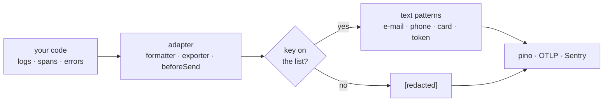

<div align="center">

# pii-allowlist

**In-process, before export: one allowlist across pino, OpenTelemetry and Sentry; unknown keys redacted by default.**

[](https://www.npmjs.com/package/pii-allowlist)
[](https://www.npmjs.com/package/pii-allowlist)
[](https://github.com/devmaxxx/pii-allowlist/actions/workflows/ci.yml)
[](https://www.npmjs.com/package/pii-allowlist)
[](./package.json)
[](https://bundlephobia.com/package/pii-allowlist)
[](./LICENSE)

[Install](#install) · [Quick start](#quick-start) · [Examples](#examples) · [OpenTelemetry](#opentelemetry) · [pino](#pino) · [Sentry](#sentry) · [API](#api) · [Limits](#limits)

</div>

A value leaves your process only when its key is on a list you wrote. Everything else becomes `[redacted]`. One dependency-free core, plus thin adapters for [OpenTelemetry](https://opentelemetry.io/), [pino](https://getpino.io/) and [Sentry](https://sentry.io/).



<details>
<summary><strong>Contents</strong></summary>

- [Why allowlist](#why-allowlist)
- [Features](#features)
- [Install](#install)
- [Quick start](#quick-start)
- [Examples](#examples)
- [OpenTelemetry](#opentelemetry) · [logs](#opentelemetry-logs)
- [pino](#pino)
- [Sentry](#sentry)
- [API](#api) · [Defaults](#defaults)
- [Compared with](#compared-with)
- [Limits](#limits)
- [Contributing](#contributing)
- [License](#license)

</details>

## Why allowlist

A denylist (`redact: ['email', 'password']`) censors the keys somebody foresaw. Code writes keys nobody foresaw: `url.full` with a query string, `db.statement` with a phone number in a `WHERE`, a `customer` object logged whole, a `taxId` field added next quarter. A denylist misses each one silently, and the leak stays invisible until someone reads the logs.

An allowlist fails the other way. A key you forgot is redacted, you see `[redacted]` in a dashboard, and you add the key. The list only has to name what your dashboards and alerts read, which is short and stable.

The same pino call, `logger.info({ userId, email, taxId, shippingAddress }, 'signup')`:

| Denylist: `pino({ redact: ['email', 'password'] })` | Allowlist: `createLogFormatter(...)` with `userId` added |
| --- | --- |
| `"userId":"u_9"` | `"userId":"u_9"` |
| `"email":"[Redacted]"` | `"email":"[redacted]"` |
| `"taxId":"DE123456789"` | `"taxId":"[redacted]"` |
| `"shippingAddress":"1 Main St"` | `"shippingAddress":"[redacted]"` |

## Features

- **Default deny.** A key not named by `keys` or `patterns` is redacted, subtree and all, at every depth.
- **Text scrubbing.** E-mail addresses, international phone numbers (`+1 (415) 555-0123` as well as `+14155550123`), payment card numbers that pass the Luhn check, JSON Web Tokens and `Bearer`/`Basic` credentials are cut out of every string that survives, in logs, span attributes and names, and Sentry events alike, so an allowlisted `message` built by interpolation stays clean.
- **URL redaction.** Query strings and fragments are always dropped; secret path segments (`/reset/:token`) are replaced.
- **Safe walk.** Inputs are never mutated; cycles become `[circular]`; depth is capped; errors are walked as `{ type, message, stack, ... }`; maps, sets and buffers are replaced whole; a `__proto__` key is copied as data; a getter that throws yields `[redacted]` instead of an exception.
- **Adapters** for an OpenTelemetry `SpanExporter` and `LogRecordExporter`; pino `formatters.log`, serializers and child bindings; and Sentry `beforeSend`, `beforeSendTransaction`, `beforeSendSpan`, `beforeSendLog` and `beforeBreadcrumb`.
- **Zero dependencies in the core.** Each adapter's framework is an optional peer. ESM only, typed, `sideEffects: false`.

## Install

```sh
npm install pii-allowlist
pnpm add pii-allowlist
yarn add pii-allowlist
bun add pii-allowlist
```

Requires Node 20 or newer. The build is platform-neutral. Add the peer for each adapter you use:

| Entry point | For | Optional peer dependency |
| --- | --- | --- |
| `pii-allowlist` | the core | none |
| `pii-allowlist/otel` | trace exporters | `@opentelemetry/sdk-trace-base` >= 2 |
| `pii-allowlist/otel-logs` | log record exporters | `@opentelemetry/sdk-logs` >= 0.200 |
| `pii-allowlist/pino` | log lines | `pino` >= 8 |
| `pii-allowlist/sentry` | error events and breadcrumbs | none: typed structurally, fits any Sentry SDK >= 8 |

## Quick start

```ts
import { createAllowlist } from 'pii-allowlist'

const allowlist = createAllowlist({ keys: ['orderId', 'status', 'items', 'sku', 'qty', 'note'] })

allowlist.redact({
  orderId: 'o_1',
  status: 'paid',
  customer: { email: 'jane@example.com', phone: '+14155550123' },
  items: [{ sku: 'A1', qty: 2, giftNote: 'for Jane' }],
  note: 'call jane@example.com',
})
// { orderId: 'o_1', status: 'paid', customer: '[redacted]',
//   items: [{ sku: 'A1', qty: 2, giftNote: '[redacted]' }], note: 'call [redacted]' }
```

## Examples

[`examples/`](./examples) holds one runnable script per adapter. Each sends the same data through without and with the allowlist and prints both:

| Script | Shows |
| --- | --- |
| [`pino.ts`](./examples/pino.ts) | a log call and a child logger: unlisted keys, an e-mail in the message, a card number |
| [`otel.ts`](./examples/otel.ts) | a server span with `url.full`, a SQL statement and a client IP, as the pipeline holds it and as it is exported |
| [`sentry.ts`](./examples/sentry.ts) | an error event, a streamed database span and a `Sentry.logger` record, before and after the hooks; no DSN needed |

The examples need Node 22.6 or newer, which can run TypeScript directly; the package itself supports Node 20.

```sh
pnpm install && pnpm build
pnpm examples                    # all three
node examples/pino.ts            # one, on Node 22.18+; on 22.6 to 22.17 add --experimental-strip-types
```

```text
--- before
{"level":30,"orderId":"o_1","email":"jane@example.com","taxId":"DE123456789","msg":"order placed for jane@example.com"}
--- after
{"level":30,"orderId":"o_1","email":"[redacted]","taxId":"[redacted]","msg":"order placed for [redacted]"}
```

A test runs every example and fails if anything it marks as personal data shows up after the allowlist.

## OpenTelemetry

```ts
import { OTLPTraceExporter } from '@opentelemetry/exporter-trace-otlp-proto'
import { BatchSpanProcessor } from '@opentelemetry/sdk-trace-base'
import { AllowlistSpanExporter } from 'pii-allowlist/otel'

const processor = new BatchSpanProcessor(new AllowlistSpanExporter(new OTLPTraceExporter()))
```

The wrapped exporter receives a copy of each span; the spans the rest of the pipeline holds are untouched. In the copy:

- only allowlisted attributes remain (default `DEFAULT_SPAN_ATTRIBUTES`); the rest are counted in `droppedAttributesCount`;
- the resource keeps only allowlisted attributes (default `DEFAULT_RESOURCE_ATTRIBUTES`: service name, version and namespace, deployment environment, `telemetry.sdk.*`); host, process and container attributes are dropped;
- events, including recorded exceptions, are dropped; links lose their attributes; the status loses its message;
- an HTTP span is renamed `METHOD /route/{template}` (or `METHOD` when no route matched); any other name loses its query string.

If a span cannot be copied (a getter throws), the batch fails with `ExportResultCode.FAILED` instead of being forwarded unfiltered. The log exporter below does the same.

To allow more attributes:

```ts
import { createAllowlist } from 'pii-allowlist'
import { AllowlistSpanExporter, DEFAULT_RESOURCE_ATTRIBUTES, DEFAULT_SPAN_ATTRIBUTES } from 'pii-allowlist/otel'

const allowlisted = new AllowlistSpanExporter(exporter, {
  allowlist: createAllowlist({ keys: [...DEFAULT_SPAN_ATTRIBUTES, 'tenant.id'] }),
  resourceAllowlist: createAllowlist({ keys: [...DEFAULT_RESOURCE_ATTRIBUTES, 'cloud.region'] }),
})
```

### OpenTelemetry logs

```ts
import { OTLPLogExporter } from '@opentelemetry/exporter-logs-otlp-proto'
import { BatchLogRecordProcessor } from '@opentelemetry/sdk-logs'
import { AllowlistLogRecordExporter } from 'pii-allowlist/otel-logs'

const processor = new BatchLogRecordProcessor({ exporter: new AllowlistLogRecordExporter(new OTLPLogExporter()) })
```

(Older `@opentelemetry/sdk-logs` releases take the exporter itself: `new BatchLogRecordProcessor(exporter)`.) The exported copy redacts attributes not on the list (default `DEFAULT_LOG_ATTRIBUTES`: `DEFAULT_LOG_KEYS` plus `exception.type`, `exception.message` and `exception.stacktrace`), keeping their keys so a missing one shows up as `[redacted]`; scrubs a string body and walks a structured one; and filters the resource as the span exporter does. This is the place to filter logs that reach OpenTelemetry without passing through pino's formatters.

## pino

```ts
import { createAllowlist } from 'pii-allowlist'
import { createLogFormatter, createMessageSerializer, DEFAULT_LOG_KEYS } from 'pii-allowlist/pino'
import pino from 'pino'

const logger = pino({
  formatters: {
    log: createLogFormatter({ allowlist: createAllowlist({ keys: [...DEFAULT_LOG_KEYS, 'orderId'] }) }),
  },
  serializers: { msg: createMessageSerializer() },
})

logger.info({ orderId: 'o_1', email: 'jane@example.com' }, 'order placed for jane@example.com')
// {"level":30,...,"orderId":"o_1","email":"[redacted]","msg":"order placed for [redacted]"}
```

Child-logger bindings skip `formatters.log`, and `formatters.bindings` only sees the base bindings. Wrap the root logger so every `child()` below it walks its bindings:

```ts
import { allowlistChildBindings } from 'pii-allowlist/pino'

const logger = allowlistChildBindings(pino({ formatters: { log: createLogFormatter() } }))
logger.child({ reqId: 'r_1', email: 'jane@example.com' }).info('hi')
// {...,"reqId":"r_1","email":"[redacted]","msg":"hi"}
```

With pino-http, pino calls `formatters.log` before its serializers, so `req` and `res` are still raw Node objects there. Pass them through to serializers that reduce them:

```ts
import { createPathRedactor } from 'pii-allowlist'
import { createLogFormatter, createRequestSerializer, responseSerializer } from 'pii-allowlist/pino'

const options = {
  formatters: { log: createLogFormatter({ passThrough: ['req', 'res'] }) },
  serializers: {
    req: createRequestSerializer({ redactPath: createPathRedactor({ tokens: ['/reset/:token'] }) }),
    res: responseSerializer,
  },
}
// req: { id: 1, method: 'GET', url: '/en/reset/[token]?[redacted]' }
// res: { statusCode: 200 }
```

## Sentry

```ts
import * as Sentry from '@sentry/node'
import { createPathRedactor } from 'pii-allowlist'
import { createBeforeBreadcrumb, createBeforeSend, createBeforeSendLog, createBeforeSendSpan } from 'pii-allowlist/sentry'

const redactPath = createPathRedactor({ tokens: ['/reset/:token', '/calendar/*/:token.ics'] })

Sentry.init({
  dsn: process.env.SENTRY_DSN,
  beforeSend: createBeforeSend({ redactPath }),
  beforeBreadcrumb: createBeforeBreadcrumb({ redactPath }),
  beforeSendSpan: createBeforeSendSpan({ redactPath }),
  beforeSendLog: createBeforeSendLog(),
})
```

`redactPath` turns `https://app.example/en/reset/s3cr3t?email=jane@example.com` into `https://app.example/en/reset/[token]`. A template matches anywhere in the URL, so an origin, an `/api` prefix or a locale in front of it does not hide the token; `*` matches any one segment and keeps it.

`beforeSend` returns a scrubbed copy of the event:

- `request` keeps only its method and its path-redacted, text-scrubbed URL; body, headers, cookies, query string and env are dropped;
- `user` is dropped;
- `extra` and the local variables (`vars`) of exception and thread stack frames keep allowlisted keys only (default `DEFAULT_SENTRY_KEYS`), walked deep;
- the transaction name, breadcrumb `url`, `from` and `to`, and breadcrumb messages that are URLs (absolute, or starting with `/`) are path-redacted;
- e-mail addresses and phone numbers are scrubbed out of the message, the `logentry` message, breadcrumb messages and exception values;
- `logentry.params` are walked as unnamed values: strings are scrubbed, objects keep allowlisted keys only;
- a transaction's `spans` and `contexts.trace.data` are scrubbed as `beforeSendSpan` does, so the same function serves as `beforeSendTransaction` under `traceLifecycle: 'static'`.

From SDK v11 spans are streamed by default and never reach `beforeSend` or `beforeSendTransaction`: without `beforeSendSpan`, `url.full`, `db.query.text` and the rest leave as recorded. `createBeforeSendSpan` drops attributes not on `spanAllowlist` (default `DEFAULT_SENTRY_SPAN_ATTRIBUTES`), scrubs the rest, and makes the name safe: `METHOD /route` for a routed server span, literals replaced by `?` in a database statement, URLs path-redacted elsewhere. For the static span shape, wrap it: `Sentry.withStaticSpan(createBeforeSendSpan())`.

`createBeforeSendLog` scrubs the message of `Sentry.logger.*` calls and redacts attributes not on `allowlist`, including `user.id`, `user.email` and `user.name`, which the SDK copies from the scope. The values a parameterized message was built from are walked as unnamed values; the SDK's own `sentry.*` metadata is kept.

Console and debug breadcrumbs lose their message and data. All helpers are typed structurally, so they fit `@sentry/node`, `@sentry/browser`, `@sentry/nextjs` and the other SDKs without importing one.

## API

### `pii-allowlist`

<details open>
<summary>Exports</summary>

**`createAllowlist(options): Allowlist`**

| Option | Type | Default | |
| --- | --- | --- | --- |
| `keys` | `Iterable<string>` | required | Keys allowed at any depth, matched exactly. |
| `patterns` | `Iterable<RegExp>` | `[]` | A key matching any pattern is allowed, e.g. `/Id$/`. |
| `redactWith` | `string \| (key, value) => unknown` | `'[redacted]'` | What a non-allowlisted value becomes. |
| `textPatterns` | `Iterable<RegExp \| TextMatcher>` | `DEFAULT_TEXT_PATTERNS` | Cut out of every surviving string; `[]` keeps strings verbatim. A `TextMatcher` is `{ pattern, accept(match) }`: only matches `accept` returns `true` for are cut. |
| `maxDepth` | `number` | `8` | Objects nested deeper are replaced whole. The top-level record is depth 0. |

The returned `Allowlist` is pure; no method mutates its input.

| Method | Returns |
| --- | --- |
| `has(key)` | whether a value under `key` may leave the process |
| `redact(value)` | a deep copy with every non-allowlisted property replaced; array items inherit their parent key's verdict |
| `redactRecord(record)` | `redact` for a record, typed as one |
| `pick(record)` | only the allowlisted top-level entries, unwalked |
| `scrubText(text)` | `text` with every text pattern replaced by `[redacted]` |

**`createPathRedactor(options?): (url: string) => string`** drops the query string and fragment, then replaces `:token` segments.

| Option | Type | Default | |
| --- | --- | --- | --- |
| `tokens` | `string[]` | `[]` | Route templates with a `:token` segment, e.g. `'/invite/:token/accept'`. A template without one throws. |
| `placeholder` | `string` | `'[token]'` | What a token segment becomes. |

Constants: `REDACTED` (`'[redacted]'`), `CIRCULAR` (`'[circular]'`), `DEFAULT_TEXT_PATTERNS`, and `TEXT_PATTERNS`, every shape this package knows by name (`email`, `phone`, `card`, `jwt`, `bearer`, `basic`, `ipv4`, `ipv6`). IP addresses are not scrubbed by default; opt in with:

```ts
createAllowlist({ keys, textPatterns: [...DEFAULT_TEXT_PATTERNS, TEXT_PATTERNS.ipv4, TEXT_PATTERNS.ipv6] })
```

</details>

### `pii-allowlist/otel`

<details>
<summary>Exports</summary>

| Export | |
| --- | --- |
| `new AllowlistSpanExporter(next, { allowlist?, resourceAllowlist? })` | `SpanExporter` that forwards allowlisted span copies to `next`, plus `shutdown` and `forceFlush`. |
| `allowlistSpan(span, allowlist, resourceAllowlist?)` | The copy of one span the exporter forwards. |
| `allowlistResource(resource, allowlist?)` | The copy of a resource the span carries. |
| `safeSpanName(name, attributes)` | The name a span is exported with. |
| `DEFAULT_SPAN_ATTRIBUTES` | Default attribute keys. |
| `DEFAULT_RESOURCE_ATTRIBUTES` | Default resource attribute keys. |

</details>

### `pii-allowlist/otel-logs`

<details>
<summary>Exports</summary>

| Export | |
| --- | --- |
| `new AllowlistLogRecordExporter(next, { allowlist?, resourceAllowlist? })` | `LogRecordExporter` that forwards allowlisted copies of log records to `next`. |
| `allowlistLogRecord(record, allowlist, resourceAllowlist?)` | The copy of one record the exporter forwards. |
| `DEFAULT_LOG_ATTRIBUTES` | Default attribute keys. |

</details>

### `pii-allowlist/pino`

<details>
<summary>Exports</summary>

| Export | Options | |
| --- | --- | --- |
| `createLogFormatter(options?)` | `allowlist` (default `DEFAULT_LOG_KEYS`), `passThrough` (top-level keys left for serializers, default none) | `formatters.log` |
| `createMessageSerializer(options?)` | `allowlist` (whose text patterns apply) | serializer for `msg` |
| `createRequestSerializer(options?)` | `redactPath`, `allowlist` | `req` serializer: `{ id, method, url }`, query shown as `?[redacted]` |
| `responseSerializer` | | `res` serializer: `{ statusCode }` |
| `allowlistChildBindings(logger, options?)` | `allowlist` (default `DEFAULT_LOG_KEYS`) | the same logger, whose `child()` bindings are walked, for every descendant |
| `DEFAULT_LOG_KEYS` | | Default log keys. |

</details>

### `pii-allowlist/sentry`

<details>
<summary>Exports</summary>

| Export | Options | |
| --- | --- | --- |
| `createBeforeSend(options?)` | `allowlist` (default `DEFAULT_SENTRY_KEYS`), `redactPath` (default drops query and fragment) | `beforeSend` |
| `createBeforeBreadcrumb(options?)` | same | `beforeBreadcrumb` |
| `createBeforeSendSpan(options?)` | same, plus `spanAllowlist` (default `DEFAULT_SENTRY_SPAN_ATTRIBUTES`; also used by `createBeforeSend` for transaction spans) | `beforeSendSpan` |
| `createBeforeSendLog(options?)` | `allowlist` | `beforeSendLog` |
| `DEFAULT_SENTRY_KEYS` | | Default breadcrumb `data`, event `extra`, stack frame `vars` and log attribute keys. |
| `DEFAULT_SENTRY_SPAN_ATTRIBUTES` | | Default span attribute keys. |

</details>

### Defaults

<details>
<summary>What each default list keeps and leaves out</summary>

| List | Contents | Left out on purpose |
| --- | --- | --- |
| `DEFAULT_TEXT_PATTERNS` | e-mail addresses; international phone numbers (`+` and 8 to 15 digits, optionally grouped by spaces, dots, dashes or parentheses); card numbers (13 to 19 digits passing the Luhn check); JSON Web Tokens; credentials after `Bearer` or `Basic` | phone numbers without a leading `+`, which cannot be told from IDs and amounts; IPv4 and IPv6 addresses, which version numbers and times resemble (`TEXT_PATTERNS.ipv4`, `.ipv6`) |
| `DEFAULT_SPAN_ATTRIBUTES` | HTTP method, route, status code, protocol version; `server.address`/`port`; `db.system`, operation, name/namespace; `messaging.system`, destination name, operation; `error.type`. Stable and older semantic-convention names. | `url.*`, `http.target`, `http.url`, `db.statement`, `db.query.text`, `client.address`, `user_agent.original`, headers |
| `DEFAULT_RESOURCE_ATTRIBUTES` | `service.name`, `service.version`, `service.namespace`, `deployment.environment`, `deployment.environment.name`, `telemetry.sdk.name`, `telemetry.sdk.language`, `telemetry.sdk.version` | `host.*`, `process.*`, `container.*`, cloud account IDs |
| `DEFAULT_LOG_KEYS` | `err`, `error`, `type`, `message`, `stack`, `cause`, `code`, `reqId`, `method`, `statusCode`, `responseTime`, `durationMs`, `count`, `event` | `name`, `url` |
| `DEFAULT_SENTRY_KEYS` | `method`, `url`, `from`, `to`, `status_code`, `request_body_size`, `response_body_size` | request bodies |
| `DEFAULT_SENTRY_SPAN_ATTRIBUTES` | `DEFAULT_SPAN_ATTRIBUTES`, plus `sentry.op`, `origin`, `source`, `sample_rate`, `segment.id`, `segment.name` (path-redacted), `release`, `environment`, `sdk.name`, `sdk.version` | `user.*`, and what `DEFAULT_SPAN_ATTRIBUTES` leaves out |

</details>

## Compared with

| | Model | Keys nobody listed | Runs |
| --- | --- | --- | --- |
| **pii-allowlist** | allowlist | redacted | in process, before export |
| pino `redact` | denylist of paths | logged in clear | in process, pino only |
| [@pinojs/redact](https://www.npmjs.com/package/@pinojs/redact) (what pino `redact` uses) | denylist of paths | logged in clear | in process |
| [fast-redact](https://github.com/davidmarkclements/fast-redact) | denylist of paths | logged in clear | in process |
| [redact-pii](https://www.npmjs.com/package/redact-pii) and similar text scrubbers | denylist of value shapes (e-mail, phone, card, SSN, IP) | sent unless a pattern recognises the value | in process, on strings |
| OTel Collector [`redaction` processor](https://github.com/open-telemetry/opentelemetry-collector-contrib/tree/main/processor/redactionprocessor) | allowlist (`allowed_keys`), plus `blocked_values` patterns | removed (fails closed unless `allow_all_keys`) | in the Collector — after the data has left the process |
| Sentry `sendDefaultPii: false` | the SDK skips some data it would collect itself | your own `extra`, breadcrumbs and messages are sent as written | in the SDK |

A denylist is the better fit when the shape of every record is known and fixed. If you already run an OpenTelemetry Collector, its `redaction` processor gives you an allowlist for spans, logs and metrics there; pii-allowlist applies one inside the process, before export, and to pino and Sentry as well.

## Limits

- **Keys, not values.** An allowlisted key carries whatever value it is given. The default text patterns catch e-mail addresses, phone numbers, card numbers and tokens; they cannot recognise a name, a street address or a national ID. Keep free-text keys off the list, or add `textPatterns` for your own formats.
- **Patterns are broad.** `/Id$/` also admits `taxId`. Prefer exact keys.
- **Card numbers are found by checksum.** One in ten digit strings of card length passes the Luhn check, so a long numeric ID inside a string is sometimes redacted.
- **Depth cap.** Objects nested deeper than `maxDepth` (default 8) are replaced whole, allowlisted or not.
- **pino child bindings need the wrapper.** `formatters.log` sees each log call's object, not `logger.child({...})` bindings; wrap the root logger with `allowlistChildBindings`. Base bindings (`pid`, `hostname`, `base`) are not walked.
- **Sentry `tags` and `contexts` are not walked**, except `contexts.trace.data`, because the SDK fills them with runtime and trace data.
- **SQL literals are found by shape.** A database span name loses `'quoted'` strings and numbers and `$$dollar-quoted$$` strings; when a backslash or an unpaired quote makes the strings ambiguous, everything from the first quote on is cut. A `"double-quoted"` value is kept, because standard SQL quotes identifiers that way: MySQL and SQLite string literals written so leak.
- **Span resources are filtered, then text-scrubbed.** Only `DEFAULT_RESOURCE_ATTRIBUTES` (or your `resourceAllowlist`) survive, and only the text patterns are cut from their values: a service name built from a customer name still leaks.
- **URLs in breadcrumb messages are found by shape.** Only whitespace-delimited words starting with `/` or a scheme (`https://…`) are path-redacted; a URL glued to other text, such as `url=/reset/s3cr3t`, is text-scrubbed only.
- **Node 20 is untested in CI.** The package declares Node >= 20; CI runs Node 22 and 24 on Linux, macOS and Windows.

## Contributing

Issues and pull requests are welcome at [github.com/devmaxxx/pii-allowlist](https://github.com/devmaxxx/pii-allowlist).

```sh
pnpm install
pnpm build       # tsdown, checked by publint
pnpm test        # vitest, examples included (after a build)
pnpm examples    # print each example's before and after
pnpm lint
pnpm typecheck
```

## License

[MIT](./LICENSE)
